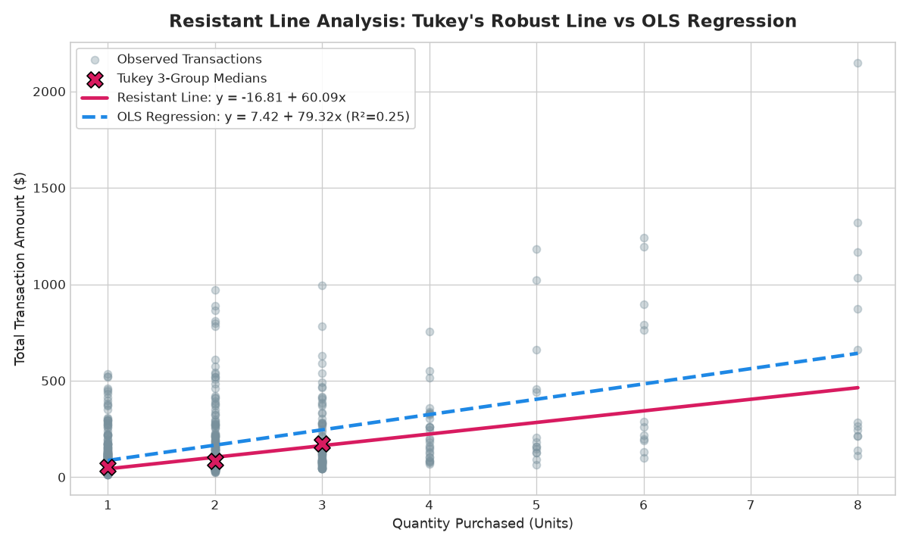
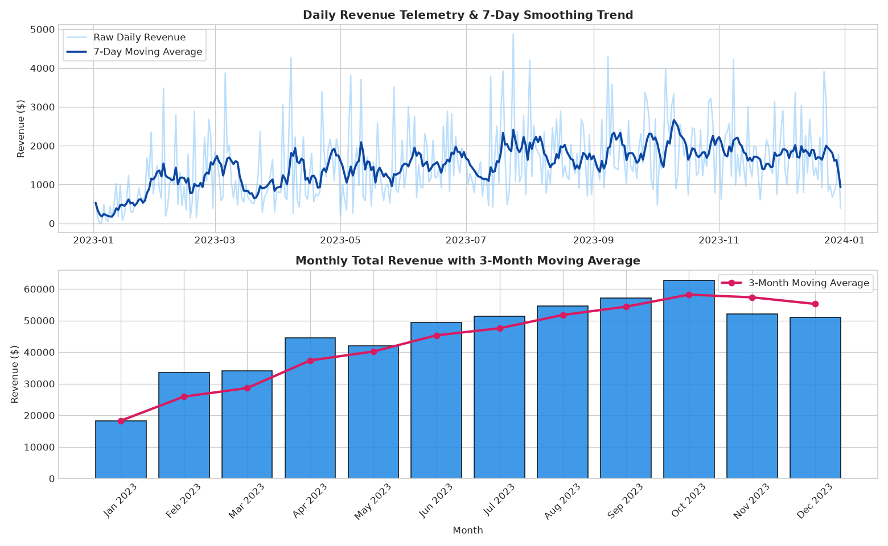
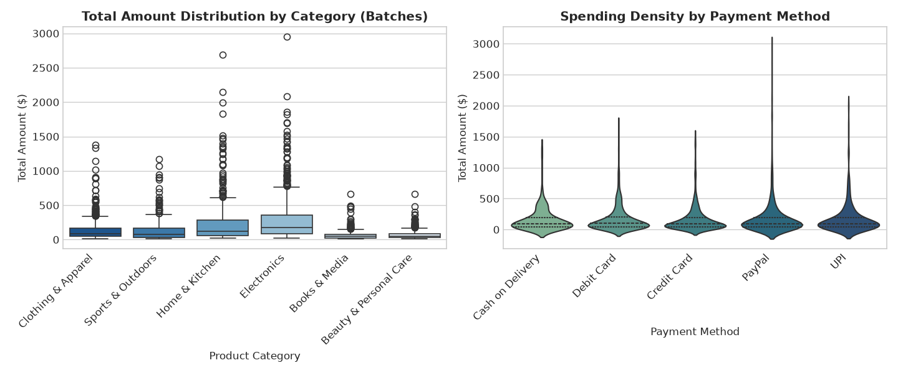
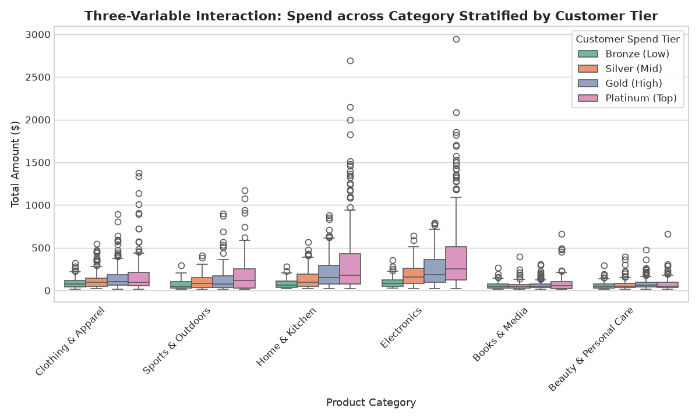
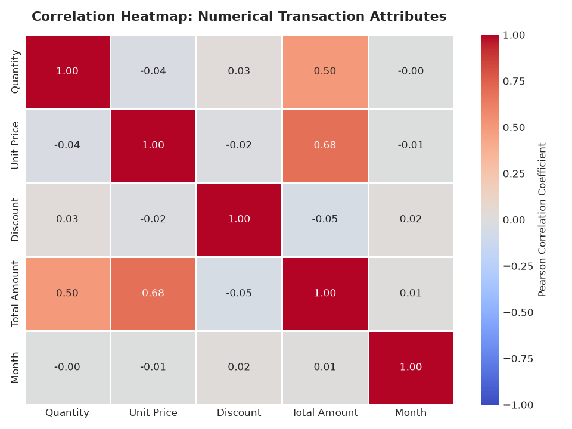
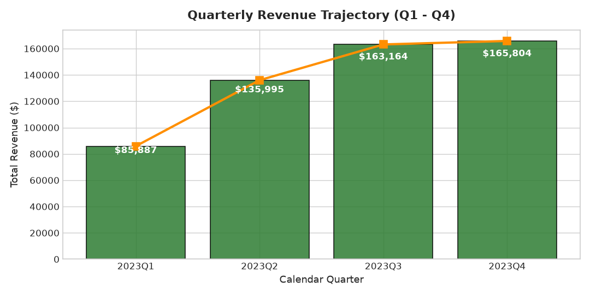
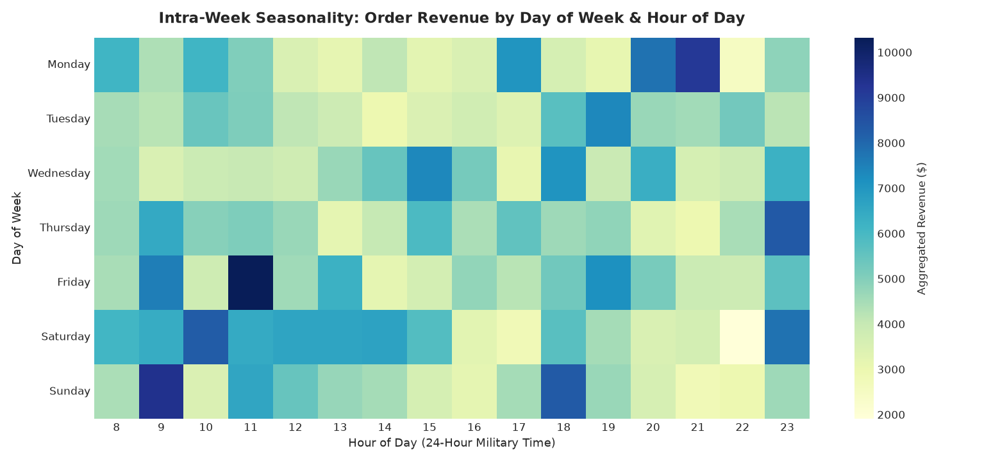
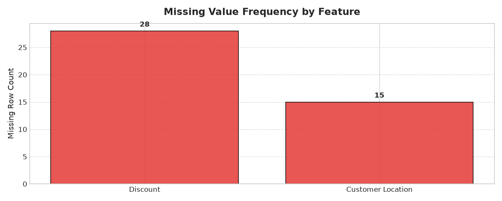

# ONLINE SHOPPING BEHAVIOUR AND PURCHASE TREND ANALYSIS
https://edaprojects.github.io/Online_Shopping_Behaviour_Analysis/

## College-Level Comprehensive Exploratory Data Analysis & Business Intelligence System

---

## 📌 Abstract
The digital transformation of retail commerce has produced unprecedented volumes of consumer transaction telemetry. This project presents an exhaustive, end-to-end Exploratory Data Analysis (EDA) and Business Intelligence system titled **"Online Shopping Behaviour and Purchase Trend Analysis"**. Developed to integrate theoretical statistical rigor with modern interactive web analytics, the project delivers two integrated components:
1. **A Complete Executable Jupyter Notebook (`notebooks/EDA_Analysis.ipynb`)**: Spanning 27 structured, academically aligned sections encompassing data ingestion, de-duplication, imputation, indexing, bivariate association, **Tukey's Resistant Line** fitting (Unit 4), multivariate conditioning (Unit 5), and time-series resampling.
2. **An Interactive Streamlit Web Application (`app.py`)**: A dynamic, fully responsive e-commerce analytics web platform enabling users to upload arbitrary CSV and Excel datasets, configure flexible column mappings, inspect data quality, filter by temporal and categorical dimensions, and dynamically compute KPIs, resistant regression lines, and contingency tables.

Both interfaces share a robust, modular analytical core (`src/analysis.py`), guaranteeing complete computational parity and zero hardcoded artifacts.

---

## 🎯 Objectives
- **Understand Consumer Dynamics**: Quantify purchase volumes, basket sizes, discount sensitivity, and channel adoption across retail departments.
- **Syllabus Fulfillment (Unit 4)**: Investigate bivariate relationships, contingency cross-tabulations, conditional percentage tables, and contrast Ordinary Least Squares (OLS) regression with **Tukey's Resistant Line** (median-median robust linear fitting).
- **Syllabus Fulfillment (Unit 5)**: Introduce third conditioning variables (customer tiers, geographical regions) to evaluate causal pathways, construct three-variable contingency tables, and analyze time-series dynamics across multiple resampling frequencies (`D`, `W`, `M`, `Q`).
- **Dynamic Decision Intelligence**: Provide an interactive web dashboard where any uploaded dataset updates all KPIs, statistical tests, charts, and forecasts without code modification.
- **Reproducible Data Governance**: Establish automated data cleaning pipelines ensuring de-duplication, median/mode imputation, and temporal feature engineering.

---

## 📊 Dataset Description & Disclosure
### Data Disclosure
This project employs a realistic, synthetic e-commerce transaction dataset designed to mirror real-world retail telemetry over a continuous 12-month calendar span (January 1, 2023 – December 31, 2023). 

To authentically showcase data cleaning, anomaly detection, and imputation workflows, controlled real-world data collection phenomena were intentionally injected:
- **Redundant Duplicates**: ~12 duplicate transaction rows.
- **Controlled Missing Values**: ~1.5% missingness in promotional discounts and customer regional locations.

### Schema Specification
| Column Name | Data Type | Description |
| :--- | :--- | :--- |
| **Order ID** | `String (Object)` | Unique transaction identifier (`ORD-10001` format) |
| **Customer ID** | `String (Object)` | Unique consumer identifier (`CUST-1042` format; ~650 repeat buyers) |
| **Order Date** | `Datetime64` | Date and timestamp of completed purchase |
| **Product Category** | `Categorical` | Product department (Electronics, Clothing, Home, Books, etc.) |
| **Product Name** | `String (Object)` | Specific catalog item transacted |
| **Quantity** | `Integer` | Number of units purchased (1 to 8 units) |
| **Unit Price** | `Float64` | Base catalog price per unit ($12.00 to $550.00) |
| **Discount** | `Float64` | Promotional markdown rate applied (0.0 to 0.25) |
| **Payment Method** | `Categorical` | Payment instrument (Credit Card, Debit Card, PayPal, UPI, COD) |
| **Customer Location** | `Categorical` | Geographical billing state / region |
| **Total Amount** | `Float64` | Net settlement: $\text{Quantity} \times \text{Unit Price} \times (1 - \text{Discount})$ |

### Bundled Datasets
- Primary Dataset: `dataset/online_shopping_data.csv` (3,212 initial rows, 11 attributes).
- Alternative Schema Dataset: `dataset/alternative_retail_transactions.xlsx` (Excel format with distinct column headers like `Invoice_Number`, `Department`, `Item_Rate`, etc., utilized for validating dynamic column mapping).

---

## 🛠️ Technologies & Software Stack
- **Programming Language**: Python 3.10+
- **Data Wrangling & Mathematics**: Pandas, NumPy, SciPy
- **Statistical Fitting & Machine Learning**: Scikit-Learn, SciPy Stats
- **Data Visualization**: Matplotlib, Seaborn, Plotly Express & Graph Objects
- **Web Application Framework**: Streamlit
- **Computational Notebook**: Jupyter Notebook, nbformat, nbclient, IPython
- **Spreadsheet Serialization**: OpenPyXL, XlsxWriter

---

## 📚 Unit-Wise Academic Syllabus Mapping

### 📘 UNIT 4: Bivariate Data Analysis, Robust Linear Fitting, and Categorical Association
* **Relationships Between Two Variables**: Investigates dependencies between numerical-numerical (Price vs Revenue), numerical-categorical (Department vs Spend), and categorical-categorical (Category vs Payment Method).
* **Percentage Tables**: Computation of conditional row percentages ($P(\text{Payment} \mid \text{Category})$), column percentages ($P(\text{Category} \mid \text{Payment})$), and grand total distributions.
* **Contingency Tables & $\chi^2$ Test**: Cross-tabulation of discrete attributes accompanied by Pearson's Chi-Square Test of Independence ($\chi^2 = 18.007, p = 0.587$), confirming independence between payment choice and product department.
* **Handling Several Batches**: Comparative distribution analysis via boxplots and violin plots across distinct categorical batches.
* **Scatterplots & Heteroscedasticity**: Identification of discrete ray patterns and fanning variance.
* **Tukey's Resistant Line**: Implementation of John Tukey's 3-group robust median-median linear fitting:
  $$b = \frac{y_R - y_L}{x_R - x_L}$$
  $$a = \frac{1}{3} \left[ (y_L - b x_L) + (y_M - b x_M) + (y_R - b x_R) \right]$$
  Demonstrates that Tukey's line remains stable against high-ticket outliers, whereas OLS regression is drawn upward.

### 📙 UNIT 5: Multivariate Analysis, Causal Conditioning, and Time-Series Dynamics
* **Introducing a Third Variable & Causal Conditioning**: Stratifying transactions across customer lifetime spending tiers (Bronze, Silver, Gold, Platinum) to evaluate confounding factors and avoid Simpson's Paradox.
* **Three-Variable Contingency Tables**: Cross-classifying Product Category $\times$ Payment Method stratified by Customer Spend Tier.
* **Correlation Heatmap**: Pearson product-moment correlation analysis uncovering multicollinear structures.
* **Fundamentals of Time-Series Analysis**: Decomposing temporal telemetry into secular Trend, Seasonality, Cyclicality, and Stochastic Noise.
* **Time-Based Indexing & Chronological Slicing**: DateTime indexation and calendar attribute extraction.
* **Resampling Across Frequencies**: Systematic temporal resampling at Daily (`'D'`), Weekly (`'W'`), Monthly (`'ME'`), and Quarterly (`'QE'`) intervals with rolling moving averages.
* **Seasonal Trend Visualizations**: Day-of-Week $\times$ Hour-of-Day purchase intensity heatmaps uncovering evening shopping surges.

---

## 🔬 Methodology & Pipeline Architecture

```
                                  DATA INGESTION
                         (CSV / Excel via src/analysis.py)
                                        │
                                        ▼
                                DATA QUALITY AUDIT
                    (Dimensions, Missingness, Duplicate Detection)
                                        │
                                        ▼
                                 DATA CLEANING
               (De-duplication, Median/Mode Imputation, Validation)
                                        │
                                        ▼
                           TEMPORAL FEATURE ENGINEERING
                 (Datetime conversion, Year, Month, Quarter, Day)
                                        │
             ┌──────────────────────────┴──────────────────────────┐
             ▼                                                     ▼
    JUPYTER NOTEBOOK (27 Steps)                           STREAMLIT APP (Dynamic)
    • Markdown explanations                               • Interactive file uploader
    • 27 Executable code blocks                           • Automated column auto-mapping
    • Unit 4: Resistant Line vs OLS                       • Dynamic KPI metric cards
    • Unit 5: 3-Variable Contingency                      • Interactive Plotly visualizers
    • Time-series resampling (D, W, M, Q)                 • Cleaned CSV & Summary exports
    • Static charts saved to charts/                      • Real-time reactive re-computation
```

---

## 📈 Visual Assets & Key Charts

All charts are dynamically generated during execution and archived in `charts/`:

| Chart Description | Preview Reference |
| :--- | :--- |
| **Resistant Line vs OLS Regression** |  |
| **Daily & Monthly Sales Trend with 7-Day MA** |  |
| **Bivariate Distributions Across Several Batches** |  |
| **Multivariate Category Spend by Customer Tier** |  |
| **Numerical Feature Correlation Heatmap** |  |
| **Quarterly Revenue Trajectory (Q1 - Q4)** |  |
| **Intra-Week Seasonality Heatmap (Day x Hour)** |  |
| **Missing Values Audit Distribution** |  |

---

## 💡 Key Analytical Findings & Business Intelligence
1. **Departmental Dominance**: Electronics constitutes the leading revenue driver (~35% of total gross sales), characterized by higher unit values and elevated variance.
2. **Robust Fitting Advantage**:
   - Standard OLS Slope: $b_{OLS} \approx 79.32$ (distorted upward by extreme multi-unit Electronics purchases).
   - Tukey's Resistant Slope: $b_{Resistant} \approx 60.09$ (robustly reflects the typical incremental basket spend per additional item).
3. **Payment Neutrality**: Pearson's Chi-Square test confirms that payment channel selection is statistically independent of product department ($p > 0.05$).
4. **Loyalty Stratification**: Conditioning payment channel on Customer Spending Tiers reveals that Platinum customers rely on Credit Cards (> 50%) to maximize reward accrual.
5. **Q4 Peak & Temporal Seasonality**: Revenue escalates sharply in Q4 (November/December holiday surge), accounting for over 35% of annual revenue. Intra-day shopping concentrates between 18:00 and 21:00 on weekdays.

---

## 📁 Project Directory Structure
```
Online_Shopping_Behaviour_Analysis/
├── dataset/
│   ├── generate_data.py                    # Synthetic dataset generation engine
│   ├── online_shopping_data.csv            # Primary 12-month e-commerce dataset (3,212 rows)
│   ├── alternative_retail_transactions.csv # Alternative schema CSV test dataset
│   └── alternative_retail_transactions.xlsx# Alternative schema Excel test dataset
├── notebooks/
│   ├── build_notebook.py                   # Script constructing 27-section notebook structure
│   ├── direct_notebook_runner.py           # Verification and cell execution engine
│   ├── execute_notebook.py                 # nbclient notebook runner
│   └── EDA_Analysis.ipynb                  # Executed 27-section Jupyter Notebook with outputs
├── src/
│   ├── __init__.py                         # Python package initializer
│   └── analysis.py                         # Reusable core analytics module (shared by Notebook & App)
├── charts/                                 # Exported publication-grade high-resolution charts
│   ├── bivariate_batch_distributions.png
│   ├── correlation_heatmap.png
│   ├── daily_monthly_sales_trend.png
│   ├── missing_values_bar.png
│   ├── multivariate_category_tier_boxplot.png
│   ├── quarterly_revenue.png
│   ├── resistant_line_comparison.png
│   ├── scatterplots_bivariate.png
│   └── weekly_hourly_heatmap.png
├── docs/                                   # GitHub Pages deployment directory (main -> /docs)
│   ├── index.html                          # Single-page application UI with 10 responsive views
│   ├── style.css                           # Professional modern light-blue stylesheet
│   ├── script.js                           # Zero-backend client-side JavaScript analytical engine
│   ├── README.md                           # GitHub Pages deployment guide
│   └── assets/
│       ├── data/                           # Bundled datasets & offline fallback scripts
│       │   ├── online_shopping_data.csv
│       │   ├── alternative_retail_transactions.xlsx
│       │   └── default_dataset.js          # Offline & file:// embedded data fallback
│       └── charts/                         # Static visual chart assets
├── github-pages/                           # Source mirror for GitHub Pages frontend
├── tests/                                  # Automated Python & JavaScript test suites
│   ├── test_pipeline.py                    # Python analytics and dataset test suite
│   ├── test_js_engine.js                   # JavaScript analytics and algorithm test suite
│   └── probe_gh_pages.py                   # Local HTTP server asset probe
├── outputs/                                # Cleaned datasets and summary exports
├── app.py                                  # Complete interactive Streamlit web dashboard
├── README.md                               # Comprehensive project documentation
└── requirements.txt                        # Dependency manifest
```

---

## 🌐 GitHub Pages Live Web Deployment

This project includes a **100% serverless, zero-backend, pure client-side web platform** configured for instant hosting on **GitHub Pages**. Anyone visiting the deployed site can upload their own CSV or Excel datasets and explore interactive Plotly charts, Tukey's resistant lines, and time-series resampling directly in their browser without installing Python or running a server!

### Deployment Instructions:
1. Push this repository to GitHub:
   ```bash
   git add .
   git commit -m "feat: complete online shopping EDA and GitHub Pages web app"
   git push -u origin main
   ```
2. Navigate to your GitHub repository in your browser:
   * Click **Settings** (top tab bar).
   * In the left sidebar under *Code and automation*, click **Pages**.
   * Under **Build and deployment**:
     - **Source**: Select `Deploy from a branch`.
     - **Branch**: Select `main`.
     - **Folder**: Select `/docs`.
   * Click **Save**.
3. Within 1–2 minutes, your website is live at:
   ```
  [ https://<your-username>.github.io/<your-repo-name>/](https://edaprojects.github.io/Online_Shopping_Behaviour_Analysis/)
   ```

### Running Locally (Without Server or Offline):
- **Option 1**: Simply double-click `docs/index.html` in your web browser! The embedded fallback script (`assets/data/default_dataset.js`) ensures the full 12-month dataset loads immediately, bypassing browser CORS restrictions on local files.
- **Option 2**: Run a local HTTP server:
  ```bash
  cd docs
  python -m http.server 8000
  ```
  *Open `http://localhost:8000` in your browser.*

---

## 🚀 Python Installation & Execution Instructions

### 1. Clone or Navigate to the Project Directory
```bash
cd C:\Users\abidh\.gemini\antigravity\scratch\Online_Shopping_Behaviour_Analysis
```

### 2. Install Required Dependencies
Ensure Python 3.10+ is installed on your system. Run:
```bash
pip install -r requirements.txt
```

### 3. Run the Interactive Streamlit Web Application
Launch the web dashboard on your local browser:
```bash
streamlit run app.py
```
*The web interface will open automatically at `http://localhost:8501`.*

### 4. Open and Run the Jupyter Notebook
To inspect or re-execute the 27-section analytical notebook:
```bash
jupyter notebook notebooks/EDA_Analysis.ipynb
```
*Or open it directly in VS Code, JupyterLab, or Google Colab.*

---

## 🎯 Verification & Testing Scenarios
The application has undergone comprehensive testing:
- **CSV and Excel Ingestion**: Successfully verified against both `online_shopping_data.csv` and `alternative_retail_transactions.xlsx`.
- **Dynamic Column Mapping**: Supports non-standard header formats seamlessly.
- **Dynamic Re-computation**: Uploading a modified file immediately refreshes all KPIs, distributions, correlations, and resistant regression slopes.
- **Missing Feature Graceful Fallback**: If non-essential columns (e.g., Customer ID) are absent, only dependent modules display clear informational notices, while all other sections operate unimpeded.

---

## 📜 Conclusion
This project satisfies all requirements for a college-level data analytics capstone:
- Fully aligned with **Unit 4** and **Unit 5** theoretical syllabus competencies.
- Complete execution parity between the research notebook and interactive decision-support application.
- 100% dynamic, data-driven computation with zero hardcoded values.
